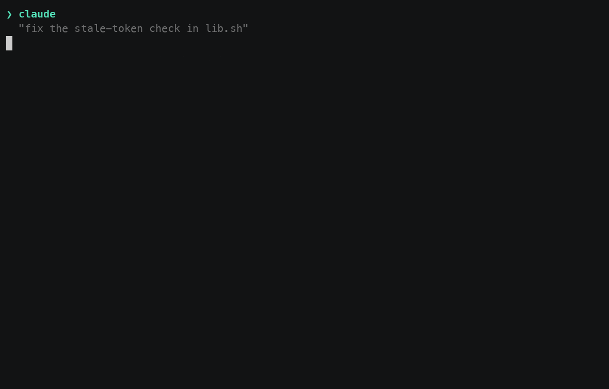
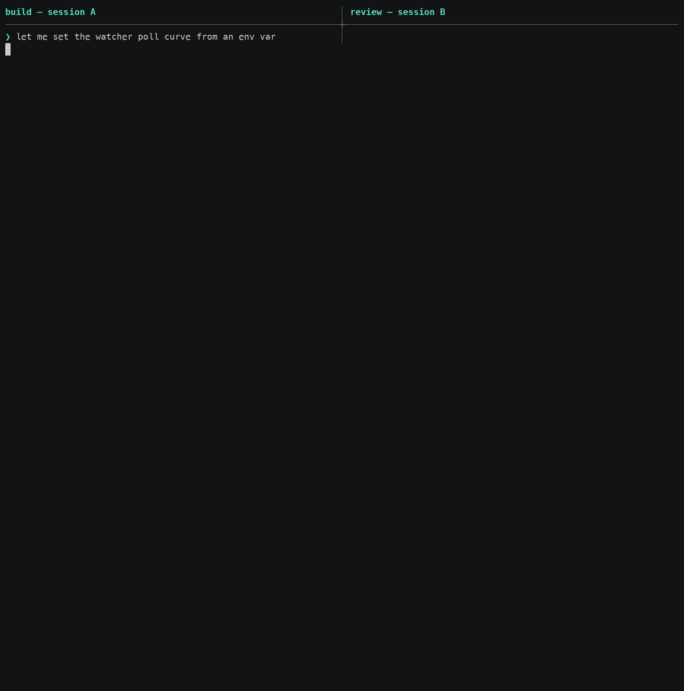
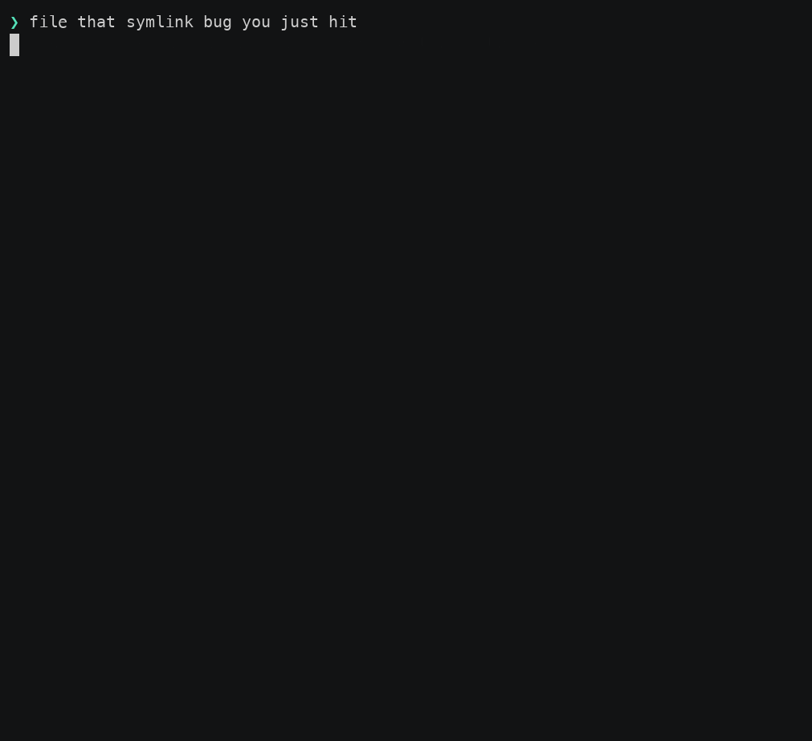
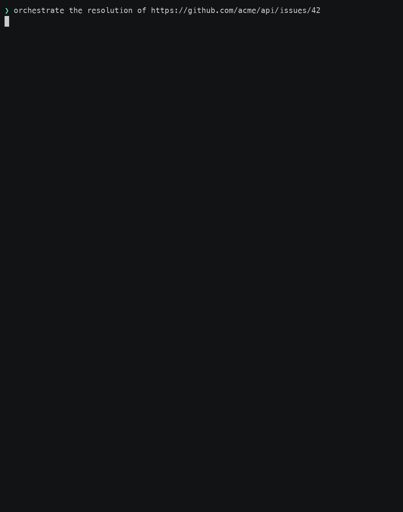
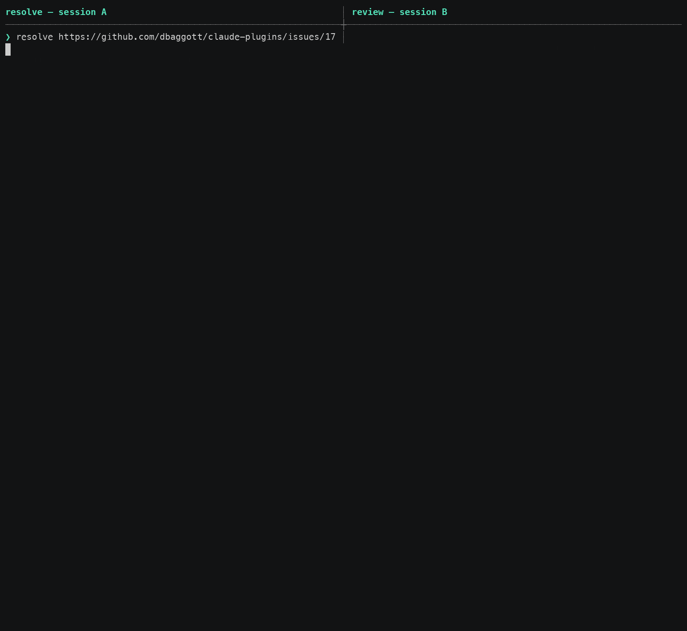
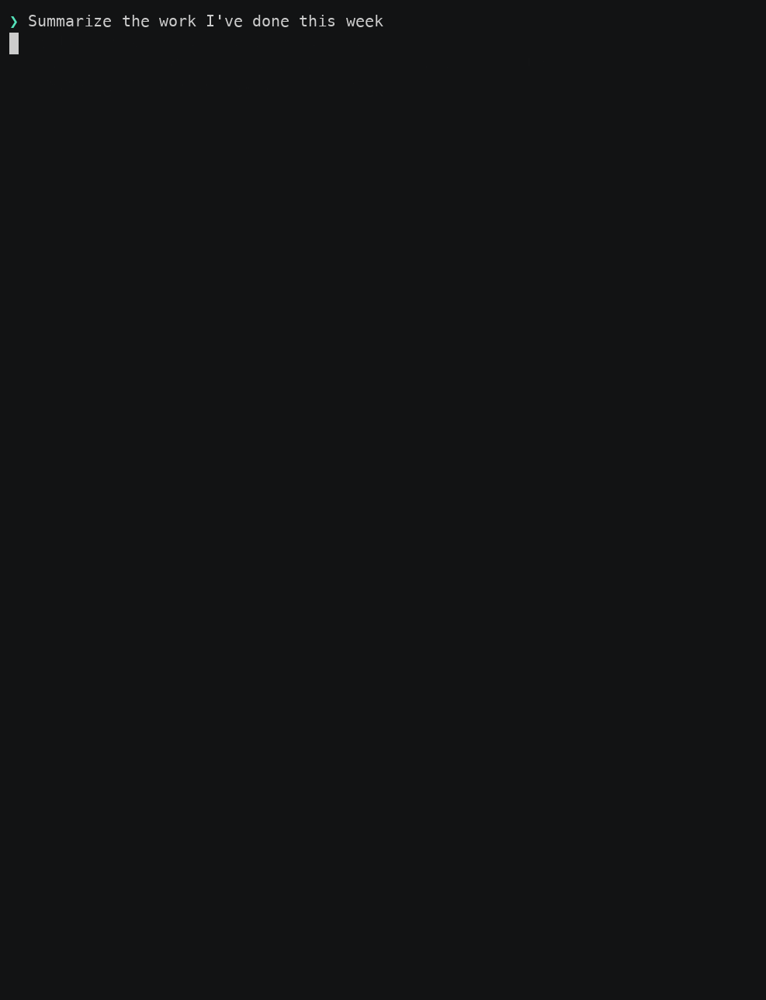

# dnbg-plugins

Opinionated [Claude Code](https://code.claude.com) plugins for shipping
software with agents on GitHub: every change through a worktree and a draft PR,
every issue written to be picked up cold, an independent reviewer bot on every
PR, and an orchestrator that drives a whole project of issues to merged PRs
while a human's attention goes only where a human is needed.



## Why

Agents are faster than the people directing them, and they do not get tired.
That inverts the usual bottleneck. The scarce resource is no longer hands on
the keyboard but the attention a human can bring to the decisions that need
one: which approach, what counts as done, whether a deviation is acceptable.
Everything else is overhead the agent should carry.

Large projects were already hard before agents. Decisions have to be made where
and when they come up and recorded somewhere useful. Items must not fall through
the cracks between the pieces. The pieces, delivered one PR at a time, have to
add up to the whole. Planning that kind of project *with* agents turned out to
be harder still: a design in a chat window dies with the session, a plan in a
notes app is one nobody else can read, and the operator ends up as the message
bus between the agent that designed, the agent that built, and the agent that
reviewed.

Meanwhile so much work gets done so quickly that it is hard to keep track of
what shipped, and the work is inherently asynchronous: an agent writes code,
then something else has to happen later. Leaving a dozen Claude Code windows
open to wait for each other does not scale. Each one is hard to find, hard to
prioritise, expensive to resume once its prompt cache has gone cold, and lost
the moment the laptop closes.

These plugins started inside a small company that decided, on purpose, that
humans would not write or review code. People would design, choose approaches
and set architecture; agents would do the rest. An agent on its own does not
produce well-designed, production-quality code, so the process had to hold up
without a human reading every diff. It leans on structure instead: roles,
reviews at each step, and a state store every participant can read. The
workflow and its prompts were developed and continuously improved over more
than 1,200 pull requests across 25 repositories, and have been extended a great
deal since, including by running on their own repository.

Two of the things it does are ones a `CLAUDE.md` structurally cannot: hooks
that *enforce* the flow rather than advise it, and an identity separate from
yours that can post a binding verdict on a PR you wrote.

## What you get

**GitHub is the state, and every session is restartable.** Code is in source
control; that is a given. The claim here is that *agentic work* has state too,
and it belongs in the same place: in issue bodies, decision-log comments, PR
descriptions and claims, or in tagged summary files on disk. A session can be
killed at any point and a fresh one started on the same URL, losing nothing but
the edit in flight. The orchestrator is built on that rule: a restart and a
first start are the same path.

**Issues are written to be picked up cold, with explicit guidance on depth.** The
session that files an issue has the whole conversation in context; the one that
resolves it has only the body. So the body carries the direction, not just the
problem: a proposed approach with the alternatives rejected and why, anchors
verified against the tree before filing, acceptance criteria runnable at that
issue's own merge, and cross-references sorted into *required reading* and
*related, do not read unless blocked*. A resolver follows a link only to answer
a specific question, and never two hops deep. Crawling the web of issues is the
most expensive thing an agent can do, so the body is built to make it
unnecessary.

**Projects run as design, decomposition, set review and execution, with a
hand-off at each stage.** A project's design is a tracking issue whose body
carries problem, goals, constraints, requirements, decisions and open questions
under stable IDs that are never renumbered. Every decision records its rationale
and its reversal condition; every open question carries a default. A design
review holds it to that. An accepted design is decomposed into sub-issues with
GitHub's own blocked-by relationships as the dependency graph, the set is
reviewed against the design for coverage, unrealised dependencies and drift, and
then one session orchestrates the children in dependency order. At the end a
closeout PR writes the as-built design into the repo. Every stage ends by
naming the prompt for the next one.

**Work is role-based, and each role has its own GitHub identity.** Author,
reviewer and orchestrator post as their own GitHub Apps, so a comment's login
says who made it and what it is for. That documents the process for the humans
reading GitHub, and it is what lets agents coordinate *through* GitHub: a watch
can wake on exactly the other party's activity, a verdict can count as
independent, and the operator's account means a human did it again.

**Reviews at every step, deviations surfaced early.** A design review before
decomposition. A spec review on every issue body, offered the moment an issue is
filed. A self-review against the coding standards and a defect pass before a PR
leaves draft. An independent review on every PR, posted as a real GitHub review
carrying exactly one binding verdict, re-run on every push until merge. For a
project, a review of the whole set of PRs against the design's end-to-end
criteria. And before implementing anything, the resolver probes the issue for
freshness and reviews it critically; a design change found mid-flight is
surfaced before the PR goes to review, not discovered inside it.

**Defer without stopping.** Not every decision deserves deep thought right now,
and an operator who is saturated should be able to park a question without
halting the work that does not need it. The plugins give you several places to
park things, each sweepable later: agent summary files with tags and a status
for ideas that turned out bigger than they looked; findings entries for the
observations a review turns up but nobody acts on today; a decision log where an
agent's question waits as a `proposed` row. An operator who is leaving can
pre-answer the pickers, delegate a class of question, and ask for stacked PRs so
approved work keeps flowing without merges. The orchestrator ends each turn on
**Your move:** and sends a notification, so attention is pulled only when it is
wanted.

**Concurrency protection.** Many sessions and agents work the same repositories
at once. An issue is claimed before it is touched, with an assignee, a label in
an open `assigned:*` namespace and a comment carrying the session id, so a
second session finds the claim and stops. Every open PR that might already
resolve the issue is found from three sources before work starts. A tracking
issue's body has exactly one writer. Each dispatched agent drafts in its own
directory. The same checks are what let an orchestrator pick up a dead
predecessor's work rather than start it over.

**Engineered for token cost.** The always-on rules are under seven hundred
words; the rest loads when a task matches a skill's description, and each skill's rarely
taken branches live in reference files sized to read in one call. Nothing polls
from inside the agent: shell scripts block on GitHub with a back-off curve and a
heartbeat, and wake the agent once with the payload it needs and a hint for what
to do with it. Bookkeeping reads run in short-lived subagents that reply in a
line. The orchestrator restarts itself before its context gets expensive to
re-send, and the agents it dispatches run on a one-hour prompt cache. Token
usage is recorded per role at every close-out, swept from the local transcripts,
and reported back with a trend, so the next round of trimming is aimed by
measurement.

**The process reviews itself.** Every role ends its part of the work with a
close-out: a report, findings entries for what it noticed about the code, and a
retrospective of where the *process* hurt. A later sweep reads a batch of
retrospectives, counts the patterns and drafts the upstream issues. The repo
that ships these plugins is run with them, so friction tends to become a PR.

**It fits how operators actually work.** Vibe-coding a one-off change, planning
an issue now to pick up later, running a multi-week project, brainstorming
something that may become a project: each has a path, each is guided along the
happy path with a recommended next step, and each can be left at any point.

## Try it

**Requirements.** Claude Code v2.1.207 or newer on macOS or Linux, with `git`,
`gh` and `jq` on your path. Creating the role Apps additionally needs `python3`,
`openssl` and `curl`. GitHub is the only supported forge; see
[`docs/forge-support.md`](docs/forge-support.md).

**Install.** Two commands, run one at a time, since the install cannot run
until the marketplace add completes:

```
/plugin marketplace add dbaggott/dnbg-plugins
```

```
/plugin install dnbg-all@dnbg
```

`dnbg-all` installs the four plugins below. Install `dnbg-workflow@dnbg`,
`dnbg-practices@dnbg`, `dnbg-work-summary@dnbg` or `dnbg-agent-summaries@dnbg`
individually to take less; the plugin is the unit you can enable or disable,
and none requires another. The install asks for a scope: `user` for one person
across many repos, `project` for one repo shared with a team
([`docs/configuration.md`](docs/configuration.md#install-scope) explains the
difference). The repo is `dnbg-plugins`, a plugin is `dnbg-workflow`, and the
marketplace is `dnbg`, hence `dnbg-workflow@dnbg`.

An install added before the plugins moved to this repository stops receiving
updates: run `/plugin marketplace remove dnbg`, then the two commands above.

**Turn the gates on.** Nothing is ever blocked until you say where. Set
`owners` to the GitHub orgs or logins you want enforced, from `/plugin`'s
configuration dialog for `dnbg-workflow`. A repo whose `origin` belongs to one
of them is *covered*: edits to tracked files in its main checkout are blocked
and redirected to a worktree, and `gh issue create` is blocked until the
issue-writing skill is loaded. Leave it empty and the skills still load and
advise, and no hook stops anything.

**Give the agents their identities.** Ask Claude Code to *set up the reviewer
bot*. The `reviewer-setup` skill creates a GitHub App per role on your account
through GitHub's manifest flow, with each App's private key staying on your
machine. The reviewer App is required for any review; the author and
orchestrator Apps are optional and fall back to your own account, with a notice
at session start.

**Then try the flows**, in a covered repo:

| Say | What happens |
| --- | --- |
| *add a `--json` flag to the export script* | A worktree, a branch, the change, a self-review, a draft PR, and a picker asking whether to send it to review |
| *file an issue for the race in the retry path* | A self-documenting issue body with verified anchors and a proposed approach, then an offer to spec-review it |
| *review `<issue URL>` as a spec* | The reviewer bot posts a verdict on the body, round by round, until it reads `READY` |
| *resolve `<issue URL>`* | The issue is claimed, probed for freshness, reviewed critically, then resolved through a PR |
| *orchestrate `<issue URL>`* | An author and a reviewer are dispatched; questions the body answers are answered; the rest come to you |
| *where is `<issue URL>`* | The stage the issue or project is at, and the exact prompt to paste next |
| *summarize this week* | A recap of your merged PRs and filed issues, shaped for the audience you name |

**Keep it current.** The plugin does not update itself. Turn on auto-update for
the marketplace (`/plugin`, then **Marketplaces**, **dnbg**, **Enable
auto-update**), or update by hand with `/plugin marketplace update dnbg`;
[`docs/releases.md`](docs/releases.md) has both, and the versioning scheme.

## How it works

### Every change goes through a worktree and a draft PR



In a covered repo, a change starts with `git fetch`, a check for open PRs that
touch the same files, and a worktree on a fresh branch. The agent commits,
self-reviews the diff against the coding standards and with the harness's
code-review tool, pushes, and opens a **draft** PR whose description reflects
the as-built state: what was verified and how, what was not, and the gaps.
Then it asks one question, *send to review?*, and on yes marks the PR ready and
arms a watch for the first review.

Review rounds are handled in the worktree: each finding is fixed or declined
with a reason, the reply goes on the thread, and the watch re-arms. When the
verdict is clean the agent hands you the merge command, composed for the state
it read, and watches for the merge. **Only a human merges.** After the merge it
cleans up the worktree and branch and gives its close-out.

What is deliberately not configurable: PRs open as drafts, the send-to-review
picker, and the merge being yours.

### Issues are handoffs



The `issue-workflow` skill treats an issue as a handoff from a session with rich
context to one with none. The body is the current truth and comments are
history, so when work ships or a referenced PR closes, the body is brought back
to true on the next touch: shipped parts marked shipped with the PR, facts that
arrived as comments promoted into the body, references that depended on a state
that changed rewritten to hold in every state.

On pickup, the resolver claims the issue, runs a cheap freshness probe (do the
named files and functions still exist, are referenced PRs in the state the body
implies), and reviews the body critically before writing any code: a confident,
well-anchored issue can still be confidently wrong. A grounded issue that passes
is implemented as written. An under-researched one gets a design from the
resolver, and that design gets the operator's buy-in before code.

Filing a plain issue ends with an offer to spec-review it now. A spec review
runs in rounds under the reviewer bot's identity, each round one comment with a
verdict, until the body reads `READY`, which is the gate before anyone implements
it.

### A project is a tracking issue, driven stage by stage



When a direction needs more than one PR, has decisions a second issue would
cite, or has an acceptance criterion no single PR can run, it is a project, and
the skill proposes a tracking issue. Its body is the design:

- **Constraints** (`C#`), each with the method that verified it, so it can be
  re-run when the world may have moved.
- **Requirements** (`R#`), each checkable.
- **Decisions** (`D#`): *the choice. Because: the rationale. Revisit if: the
  reversal condition.* The rationale is what a later reader extends to cases
  the text never mentions.
- **Open questions** (`Q#`), each with a default a resolver may take without
  asking.
- **End-to-end acceptance criteria** (`A#`), the ones no single child can run.
- A **decision log** and a **findings log**.

IDs are never renumbered or deleted; a retired entry stays, marked. Children,
PRs, commits and reviews cite them, and at closeout the as-built design is
written into `docs/design/` so they still resolve after the issue closes. The
four designs under [`docs/design/`](docs/design/) are this repo's own, written
this way.

Each stage hands off to the next with a prompt, and `where is <URL>` tells you
which one you are at:

| Stage | Prompt | Who acts |
| --- | --- | --- |
| Design | file the tracking issue, then `review <URL> as a spec` | the filing session and the reviewer bot, in rounds, in design mode |
| Accept | `answer the spec review on <URL>` | you, recorded as a decision-log row |
| Decompose | `decompose <URL>` | a session files the children as sub-issues with blocked-by edges, then hands the set to review |
| Set review | automatic after decomposition | the reviewer bot checks coverage, unrealised dependencies and drift against the design |
| Execute | `orchestrate <URL>` | the orchestrator, in a fresh session |
| Close out | merge the closeout PR | you |

The orchestrator reads everything from GitHub, claims the parent, computes the
ready set (open children whose blockers are closed as completed, unclaimed, with
a `READY` verdict), and dispatches an author and a reviewer per child, up to a
concurrency cap. It owns coordination state and never artifact state: the PR,
the verdict and the child's body belong to the author and the reviewer, and it
relays rather than judges. A question from an author is triaged against the
design under a short allowlist of what the orchestrator may decide alone;
everything else escalates to you. Every answer is a `Decision log:` row on the
issue, with the question, the answer and its basis, and a `decided` row is
promoted into the body so a cold reader never needs the log. A decision that
changes the design sweeps every child that cites the affected IDs and re-runs
their spec review before anything is dispatched on them. Recurring questions and
recurring review findings across children are raised as systemic findings.

Across the whole flow you are needed at these points, and nowhere else:
deciding that a discussion is a project, when the filing session asks; signing
off the design; answering the orchestrator's escalations; looking at the work
before review, on an issue that declares an operator check; merging each PR;
and approving the text of every follow-up the closeout files. You approve the
design, not the children: the set review's `READY` on every child is that gate,
and a child reaches you only through an escalation.

### Roles and identities

| Role | Posts | Without an App |
| --- | --- | --- |
| `reviewer` | PR reviews, inline comments, spec-review verdicts | refuses; a reviewer posting as you cannot approve your PR and deadlocks the author's watch |
| `author` | PRs, descriptions, thread replies, pushes; issues filed, claimed, edited, commented | posts as you |
| `orchestrator` | claims, decision-log rows, questions and tracking-issue edits | posts as you |

Each role is a GitHub App you create on your own account; its key never leaves
your machine, and each write mints a short-lived token for exactly that
command. Commits stay authored by you. A role is a directory of data (its
permissions and fallback policy), so adding one is a file, not a refactor.
[`docs/configuration.md`](docs/configuration.md#agent-roles--whose-login-each-agent-posts-under)
has the permissions and key handling, and
[`SECURITY.md`](SECURITY.md) what a leaked key can reach.

### Reviews at every step



| Review | On | By | Catches |
| --- | --- | --- | --- |
| Design review | a tracking issue's body | `issue-reviewer`, design mode | missing rationale, questions with no default, uncheckable requirements, disguised operator questions, constraints that do not re-verify |
| Spec review | any issue body | `issue-reviewer` | a body a cold resolver would get wrong |
| Set review | a parent and its children | `issue-reviewer` | uncovered requirements, dependencies not declared, a child contradicting the section it cites |
| Critical review | the issue, at pickup | the resolver | misidentified problem, symptom not cause, false premise |
| Self-review | the diff, before the PR leaves draft | the author, with the standards and the harness's code-review tool | what a reviewer round would cost to find |
| Operator check | the running work, before the self-review | you, when the issue declares one | what only a look at the UI shows |
| Code review | every pushed PR | `reviewer`, as the bot | one binding verdict per round, re-run on every push |
| Project review | the closeout PR | `reviewer`, issue mode | the union of merged PRs against the end-to-end criteria |

The reviewer can be assigned to an issue before any PR exists. It waits, holds
back while the PR is a draft, since a draft is the author's signal that the
work is not ready for anyone's attention, and starts the moment the PR is
marked ready. It reads CI's results rather than re-running the suite, because
a local run reproduces the author's environment rather than CI's, and every
green run then argues "flaky, ignore it". A re-review diffs against the
last-reviewed commit rather than re-reading the whole change.

A finding is answered with the most durable artifact available: a test beats
the code, which beats prose, so each round leaves a guard behind rather than a
thread nobody re-reads. A mid-implementation design change is surfaced in chat
before the PR goes to review. Under an orchestrator, an author that reports a
departure as already built is treated as having asked: an answer other than
the change as built sends it back.

### Deferring without stopping

- **Agent summaries** (`dnbg-agent-summaries`): one Markdown file per topic in a
  directory outside any repo, tagged by kind and project, with a status of
  `active`, `superseded` or `retired`. Research, a design proposal, an issue
  draft, notes to pick up later. *Sweep the summaries* proposes what to archive.
- **Findings entries** (`findings-review`): every finding about the code that a
  report lists but nobody acts on today is written to a file with the commit it
  was observed at. *Review the findings* re-checks each against the current
  default branch, merges duplicates, and proposes filing, dropping or keeping.
- **Delegated mode**: a dispatched agent has no one to ask, so a question it
  cannot answer from its prompt or the issue's defaults is posted as a
  `Delegated question:` comment and the agent ends its turn. It never picks
  silently.
- **Pre-answered pickers and delegated classes**: the two pickers in a resolve
  exist so *you* decide, not so you have to be at the keyboard. *I'll be afk:
  resolve `<URL>`, send it to review when you're done, and auto-handle any
  reviewer feedback* settles both in advance, and the session runs to a clean
  verdict and reports back. *Take the default on anything about X* is recorded
  as a decision the orchestrator cites each time it applies it.
- **Stacked mode**: *orchestrate `<URL>`, stacked* bases a child's PR on its
  blocker's approved, unmerged branch, so an operator who is away for a day
  comes back to a stack one merge lands.
- **The closing line**: a turn that ends on you ends on **Your move:** with the
  action and its command, or **Done:** with what is still running, and a
  notification when your attention is wanted.

### Concurrency protection

- A claim is three marks: the assignee, an `assigned:*` label, and a comment
  carrying the session id. The namespace is open on purpose, so another tool's
  claim is seen without this plugin knowing its name. A foreign claim stops the
  pickup; a stale one (old comment, no open PR) is pointed out, and going past
  it is your call. A reviewer deliberately withholds the same marks, so they
  keep meaning *someone is implementing this*.
- Before any work, every PR that might already resolve the issue is found from
  closing references, timeline cross-references and text search, and an open
  one stops the pickup. A source that failed is reported, never read as empty.
- Two sessions opening PRs against the same files is checked at the start of
  every change, from the open PR list.
- A tracking issue's body has one writer while its children are being worked.
  Everyone else leaves what the body should carry where its record already
  lives, for that writer to collect.
- Each dispatched agent gets its own draft directory, and background tasks are
  stopped by id, never by pattern, since several agents watch one PR.
- An orchestrator claims a child before dispatching its author, so the ready set
  cannot offer it twice; a restarted orchestrator finds its predecessor's claim
  and asks once before taking over.

### Engineered for token cost

- **Progressive loading.** The always-on rules are injected at session start
  and into every subagent, and kept to what cannot be triggered by intent.
  Everything procedural is a skill, loaded when its description matches, and
  each skill's rarely taken branches are reference files sized to be read in
  one tool call; a test pins the cap. Rules that several skills restate exist
  once, and the others point at it.
- **Scripts do the waiting.** No agent polls. `watch-pr.sh` and
  `watch-issue.sh` block on GitHub with a poll interval that backs off from ten
  seconds to five minutes as a PR stays quiet, measured on an awake clock so a
  closed laptop is not charged as waiting. They print a heartbeat so a dead
  watch cannot pass for a quiet one, fetch the review round themselves, and
  wake the agent once with a result line carrying what to do next. One
  role-aware watch per PR, shared by author and reviewer.
- **Scripts do the writing too.** The `gh`, `jq` and GraphQL that used to be
  copied into skill prose is in `dnbg-workflow/scripts/`, where shellcheck and
  the test suite can reach it. A decision-log row and its parent-table row go
  up in one call; a claim is one call; the ready set is one call.
- **The orchestrator stays small.** Bookkeeping reads (collecting children's
  rows, sweeping siblings after a merge, scanning for recurring findings) run in
  short-lived subagents that reply in one line. The orchestrator reads its own
  context size each wake and restarts itself before it is expensive to re-send,
  draining in-flight authors to pushed PRs first. Dispatched authors and
  reviewers run on a one-hour prompt cache, since they idle through review
  rounds and CI.
- **Measured, not guessed.** Each close-out records its run's token usage in its
  retrospective's frontmatter and, for a session owner, as a `Usage:` comment on
  the issue. A sweep over the local transcripts attributes usage by role, wake
  and plugin file read, and the process review reports both against its
  previous report. A `Read but not used` heading in every retrospective names
  the reference files that did not earn their load, and a file named by several
  becomes a split candidate.
- **Prose is tested.** `scripts/dev/prose-ab.sh` runs an eval case against two
  trees differing in one passage of skill text and scores both, to settle
  whether a passage is load-bearing before it is cut or kept.

### The process reviews itself

Every role ends its part with a close-out under three headings: **Summary**,
**Observations** and **Actionable**, with Actionable kept narrow so it is the
one you skim. Findings about the code become findings entries. Where the
process hurt (what slowed or blocked the agent, what a skill got wrong, what it
worked around, what it wished it could ask, what it read but did not use) goes
into a retrospective file when the `retrospectives` setting is on, or, when it
is off, the severe classes are surfaced in the report with an offer to file them
upstream.

*Review the retrospectives* reads a batch, reports the patterns with counts and
quoted examples and the usage by role, and drafts upstream issues for your
approval. The repo that ships these plugins is run this way; its issue tracker
is largely the output of that loop.

### Keeping track of what shipped



`dnbg-work-summary` turns *summarize yesterday*, *what shipped this week* or
*what am I working on* into a recap of your merged PRs and filed issues, read
from the PR descriptions rather than the diffs. It settles audience, format and
detail before writing, and refuses to claim more than the descriptions do.

### Coding standards that reach every agent

`dnbg-practices` carries engineering rules with citable IDs: design over
expediency, security, naming, the comment bar, prose that instructs an agent,
logging, verification and sizing. The author loads them before writing and the
reviewer before reviewing, so a finding cites a rule rather than re-arguing it.
A project's own standards win where the two disagree. It mentions no forge and
installs on its own.

### Optional: the velocity trade

`velocity-tradeoff` is for a project that has explicitly opted, in its own
`CLAUDE.md`, into trading safety margin for speed: whole capabilities in one PR,
no migration shims, heavy automated tests anyway. It is off unless a repo asks
for it, because it removes protections most projects need.

## What's in it

| Plugin | Skills | Hooks | Forge |
| --- | --- | --- | --- |
| `dnbg-workflow` | `git-workflow`, `issue-workflow`, `issue-reviewer`, `reviewer`, `reviewer-setup`, `orchestrate`, `project-status`, `findings-review`, `process-review`, `velocity-tradeoff` | five, below | GitHub, except `velocity-tradeoff`, `findings-review` and `process-review`, which read no forge |
| `dnbg-practices` | `coding-practices` | none | any |
| `dnbg-work-summary` | `work-summary` | none | GitHub, by account rather than by repo |
| `dnbg-agent-summaries` | `summary-review` | none | any |
| `dnbg-all` | installs the four above | | |

Forge-neutral is a property of the skill, not the plugin;
[`docs/forge-support.md`](docs/forge-support.md) has the per-skill table and
what each skill does on a host it does not support.

The hooks, all in `dnbg-workflow`:

| Hook | Fires | Does |
| --- | --- | --- |
| `inject-rules.sh` | session start | puts the always-on rules, and any configuration overrides, in context |
| `inject-rules-subagent.sh` | subagent start | the same, for every subagent, since session-start output reaches only the main loop |
| `role-fallback-notice.sh` | session start | names any role that will post as you because it has no App |
| `check-worktree.sh` | before `Edit`, `Write`, `NotebookEdit` | blocks an edit to a tracked file in a covered repo's main checkout |
| `check-issue-create.sh` | before `Bash` | blocks `gh issue create` against a covered repo until `issue-workflow` is loaded |

The hooks make no network calls, write no files and hold no credentials. Both
gates fail open: without `jq` or `git` they stop protecting rather than stop
you, and the session-start hook says so once. The first demo above is real
output from `check-worktree.sh`, `git` and the GitHub API; the others are
reenactments, because the pickers and the agent's dialogue never reach
stdout, and CI checks each one still matches its script.

## Configuration

Every setting is optional, and only `owners` turns enforcement on. The others
move the mechanical opinions (where worktrees go, the claim label, where
retrospectives and findings are kept), stamp what you publish with the plugin
version, or turn retrospective files on.
[`docs/configuration.md`](docs/configuration.md) covers each, with why its
default is what it is.

## Documentation

- [`docs/configuration.md`](docs/configuration.md): every setting, install
  scope, agent roles and key handling.
- [`docs/forge-support.md`](docs/forge-support.md): GitHub only, and what each
  skill does elsewhere.
- [`docs/requirements.md`](docs/requirements.md): the Claude Code floor and the
  command-line tools.
- [`docs/releases.md`](docs/releases.md): updating, CalVer, what triggers a
  release.
- [`docs/design/`](docs/design/): the as-built designs of this repo's own
  projects, which are also worked examples of a tracking issue.
- [`SECURITY.md`](SECURITY.md): what installing this grants, the role Apps'
  keys, reporting a vulnerability.
- [`CONTRIBUTING.md`](CONTRIBUTING.md) and [`docs/maintainers.md`](docs/maintainers.md).
- The skills themselves, under `dnbg-*/skills/`: they are the product, and the
  philosophy in full.

## Contributing

Maintained by [Dan Baggott](https://www.linkedin.com/in/dan-baggott/).
Issues are welcome: bug reports, misfires of a gate, portability findings,
documentation corrections. Pull requests from outside contributors are not
merged for now, since there is no contributor agreement yet; an issue first is
cheaper for both sides. The opinions are not up for swapping, but making one
configurable with the current behaviour as the default is a welcome proposal.
[`CONTRIBUTING.md`](CONTRIBUTING.md) has the scope and the mechanics.

## License

Available under either of two licenses, at your option ([`LICENSE`](LICENSE)).
PolyForm Internal Use 1.0.0 covers a company's internal use, including while
building products it sells, and allows changes for that use. PolyForm Strict
1.0.0 covers personal and hobby use, without changes. Neither allows
distributing the plugins, so neither allows selling them.
